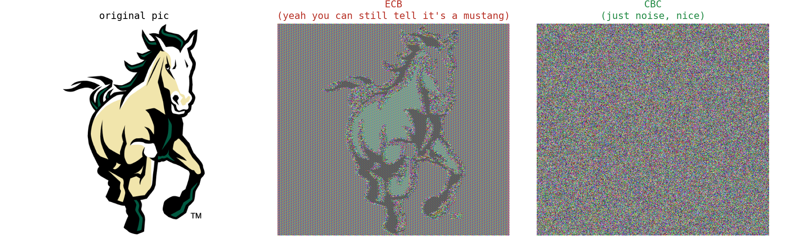
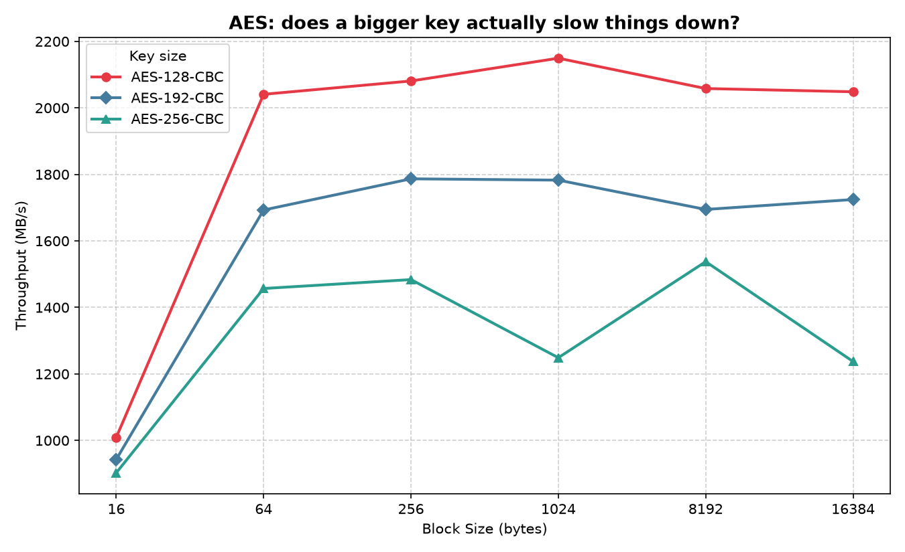
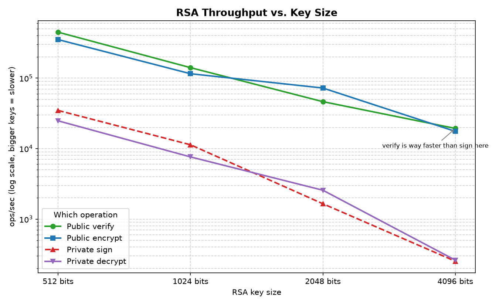

# Applied Cryptography & Security Lab: Symmetric & Asymmetric Cryptosystems

A hands-on implementation and empirical analysis of symmetric ciphers (AES modes, padding, bit-flipping attacks) and asymmetric performance characteristics (RSA vs. AES benchmarking).

---

## 📌 Overview

This project explores foundational concepts in applied cryptography, focusing on block cipher construction, mode security, active integrity attacks, and cryptographic performance trade-offs. The lab is divided into three core tasks:

1. **Task 1: AES Modes of Operation (ECB vs. CBC)**  
   Low-level implementation of AES encryption and decryption in Electronic Codebook (ECB) and Cipher Block Chaining (CBC) modes from scratch with PKCS#7 padding, demonstrating pattern leakage using bitmap image headers.
2. **Task 2: Chosen Ciphertext & CBC Bit-Flipping Attack**  
   Exploiting the malleability of CBC mode without cryptographic integrity verification to forge an administrative session token (`";admin=true;"`) and bypass application-layer sanitization.
3. **Task 3: Performance Benchmarking (AES vs. RSA)**  
   Empirical benchmarking and performance analysis of symmetric (AES-128/192/256) versus asymmetric (RSA-512/1024/2048/4096) cryptographic primitives using OpenSSL and Python visualization.

---

## 📂 Repository Structure

```text
├── task1_modes.py           # Core implementations: PKCS#7 padding, AES-ECB, AES-CBC, file/BMP helpers
├── task2_oracle_attack.py   # Web cookie oracle simulation & CBC bit-flipping exploit
├── task3_performance.py     # OpenSSL speed benchmark runner and Matplotlib graph generator
├── main.py                  # End-to-end driver running all tasks, tests, and visual comparisons
│
├── mustang.bmp              # Original test image (Cal Poly Mustang logo / photo)
├── mustang_ecb.bmp          # ECB-encrypted bitmap (leaking visual structure)
├── mustang_cbc.bmp          # CBC-encrypted bitmap (pseudo-random noise)
├── bmp_comparison.png       # 3-panel side-by-side visual comparison figure
│
├── aes_performance.png      # Plot: AES throughput vs. block size & key size
├── rsa_performance.png      # Plot: RSA ops/sec across public vs. private operations
├── plaintext.txt            # Sample plaintext payload for round-trip testing
└── README.md                # Project documentation
```

---

## ⚙️ Prerequisites & Setup

### Requirements
- **Python**: 3.10+
- **OpenSSL**: Installed and accessible in your system `PATH` (for Task 3 benchmarks)
- **Python Libraries**:
  - `pycryptodome` (for basic AES block primitive)
  - `matplotlib` (for graphing performance curves and image comparisons)
  - `pillow` (for loading and rendering bitmap images)

### Installation

```bash
# Clone the repository
git clone https://github.com/your-username/SecurityMod2.git
cd SecurityMod2

# Install dependencies
pip install pycryptodome matplotlib pillow
```

Verify OpenSSL is installed:
```bash
openssl version
```

---

## 🔬 Technical Breakdown & Implementation

### 1. Task 1: AES Modes of Operation (ECB vs. CBC)

#### Implementation Details
- **PKCS#7 Padding**: Implemented manually to ensure plaintext inputs align with AES's 16-byte (`BLOCK_SIZE = 16`) boundary. For input length $L$, the padding length is $P = 16 - (L \pmod{16})$. If $L$ is an exact multiple of 16, a full 16-byte block of `0x10` is appended to prevent ambiguity during unpadding.
- **Electronic Codebook (ECB)**:
  $$C_i = E_K(P_i)$$
  Each 16-byte block is encrypted independently with key $K$.
- **Cipher Block Chaining (CBC)**:
  $$C_0 = E_K(P_0 \oplus \text{IV}), \quad C_i = E_K(P_i \oplus C_{i-1})$$
  $$P_0 = D_K(C_0) \oplus \text{IV}, \quad P_i = D_K(C_i) \oplus C_{i-1}$$
  Chaining previous ciphertext blocks eliminates the deterministic mapping between identical plaintext blocks and identical ciphertext blocks.

```
       CBC Encryption                                  CBC Decryption
  Plaintext Block (Pi)                             Ciphertext Block (Ci)
           │                                                │
           ▼                                                ▼
     [ ⊕ XOR ] ◄── Prev Ciphertext (Ci-1)            [ Block Decrypt ]
           │                                                │
           ▼                                                ▼
   [ Block Encrypt ]                                 [ ⊕ XOR ] ◄── Prev Ciphertext (Ci-1)
           │                                                │
           ▼                                                ▼
  Ciphertext Block (Ci)                            Plaintext Block (Pi)
```

#### The BMP Image Experiment
A standard uncompressed Windows BMP file consists of a 54-byte header (storing metadata such as file dimensions and color depth) followed by raw pixel data. By preserving the 54-byte header in plaintext and encrypting only the pixel byte stream:
- **ECB Mode**: Identical pixel blocks (e.g., solid background color or uniform textures) produce identical ciphertext blocks. The high-level shape, edges, and contrast of the original image remain clearly visible.
- **CBC Mode**: Because each ciphertext block depends on all prior blocks and an initial pseudorandom IV, identical pixel blocks encrypt to distinct pseudorandom ciphertext blocks, completely diffusing all visual patterns into white noise.



---

### 2. Task 2: Chosen Ciphertext & CBC Bit-Flipping Attack

#### Threat Model & Oracle Setup
A simulated authentication server issues an encrypted session token via a `submit(user_input)` function:
```python
full_string = "userid=456;userdata=" + sanitize(user_input) + ";session-id=31337"
```
The server sanitizes user input by URL-encoding `;` (`%3B`) and `=` (`%3D`), preventing users from directly injecting administrative parameters. When validating a token, `verify(ciphertext)` decrypts the token under CBC mode and checks if `";admin=true;"` is present in the decrypted string.

#### Attack Mechanics (Malleability of CBC)
Because CBC decryption computes $P_i = D_K(C_i) \oplus C_{i-1}$, tampering with byte $j$ of ciphertext block $C_{i-1}$ introduces a predictable bit-flip into byte $j$ of plaintext block $P_i$:

$$P_i'[j] = D_K(C_i)[j] \oplus C_{i-1}'[j] = P_i[j] \oplus (C_{i-1}[j] \oplus C_{i-1}'[j])$$

#### Exploit Steps:
1. **Block Alignment**:
   - `Block 0 (0–15)`: `"userid=456;userd"` (16 bytes)
   - `Block 1 (16–31)`: `"ata="` (4 bytes) + 12 filler bytes `"AAAAAAAAAAAA"` (total 16 bytes)
   - `Block 2 (32–47)`: `":admin<true:"` (12 bytes) + `";sess"` (4 bytes)
2. **Payload Injection**: Submit `12 * 'A' + ':admin<true:'`. The characters `:` (`0x3A`) and `<` (`0x3C`) differ from `;` (`0x3B`) and `=` (`0x3D`) by exactly 1 bit and pass sanitization without escaping.
3. **Ciphertext Modification**: XOR the corresponding bytes in Block 1 of the ciphertext:
   - $C_1[0]' = C_1[0] \oplus \text{ord}(':') \oplus \text{ord}(';')$
   - $C_1[6]' = C_1[6] \oplus \text{ord}('<') \oplus \text{ord}('=')$
   - $C_1[11]' = C_1[11] \oplus \text{ord}(':') \oplus \text{ord}(';')$
4. **Result**: Block 1 decrypts into random pseudo-garbage during validation, but Block 2 decrypts cleanly as `";admin=true;"`, granting elevated privileges without knowing the secret encryption key.

> **Key Takeaway**: Encryption alone provides *confidentiality*, not *integrity* or *authenticity*. Production systems must use Authenticated Encryption with Associated Data (AEAD) like **AES-GCM** or combine CBC with an **HMAC (Encrypt-then-MAC)**.

---

### 3. Task 3: Performance Analysis & Benchmarking

Using OpenSSL's internal benchmarking suite (`openssl speed`), we measure empirical throughput across varying block sizes and key lengths.

#### AES Performance (`aes_performance.png`)
- **Block Size Scaling**: Small buffer sizes (16–64 bytes) incur substantial function call and context-switching overhead per byte. Throughput scales logarithmically and plateaus as buffer sizes approach 8 KB – 16 KB.
- **Key Length Impact**: AES-128 (10 rounds), AES-192 (12 rounds), and AES-256 (14 rounds) show marginal throughput differences on modern CPUs due to hardware-assisted instructions (Intel AES-NI).



#### RSA Performance (`rsa_performance.png`)
- **Public vs. Private Operation Asymmetry**:
  - **Public Operations (Verify / Encrypt)** use a small fixed public exponent ($e = 65537 = 2^{16} + 1$), requiring only 17 modular multiplications.
  - **Private Operations (Sign / Decrypt)** use a full-length private exponent $d \approx N$, requiring thousands of modular exponentiations (even when optimized using the Chinese Remainder Theorem).
  - Consequently, RSA verification is $10\times$ to $100\times$ faster than signing.
- **Key Length Scalability**: Doubling the RSA key size (e.g., 2048-bit to 4096-bit) causes roughly an $8\times$ degradation in signing performance ($O(k^3)$ complexity).



---

## 🚀 Execution & Usage

### Running the Full Suite
To execute all three tasks sequentially (image generation, attack simulation, and benchmark plotting):

```bash
python main.py
```

### Running Individual Tasks
Each module is self-contained with its own test harness:

```bash
# Task 1: Self-tests for ECB/CBC encryption & padding
python task1_modes.py

# Task 2: Demonstration of URL-sanitization bypass via bit-flipping
python task2_oracle_attack.py

# Task 3: OpenSSL benchmark runner & plot generator
python task3_performance.py
```

---

## 📚 Key Takeaways

1. **Never use ECB mode for structured data**: Preserving block independence leaks entropy and perceptual data patterns.
2. **Unauthenticated ciphertexts are malleable**: Without MAC verification or AEAD, active attackers can manipulate decrypted plaintexts deterministically.
3. **Symmetric vs. Asymmetric Roles**: AES provides gigabytes-per-second throughput suitable for bulk data transfer, whereas RSA is compute-heavy and strictly suited for key exchange and digital signatures (hybrid cryptosystems).
